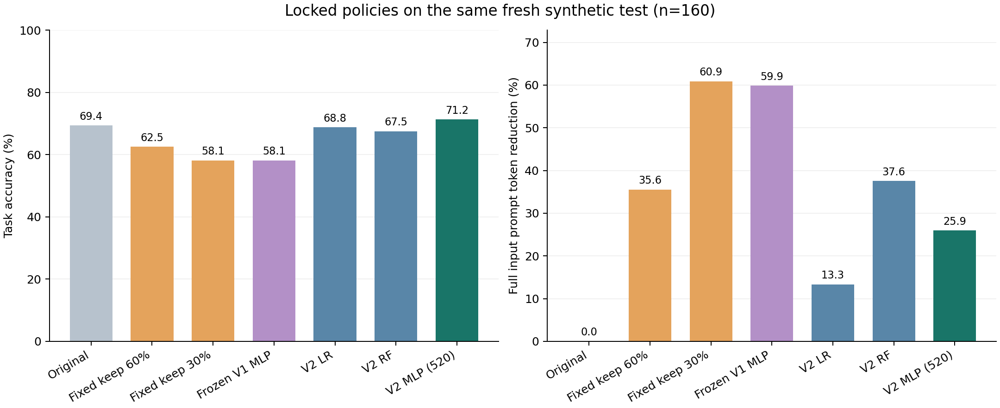
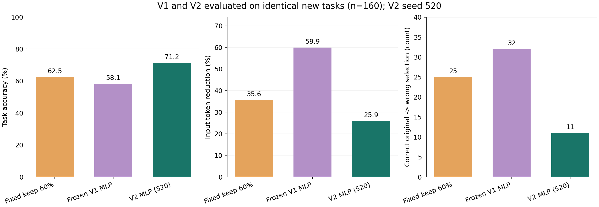
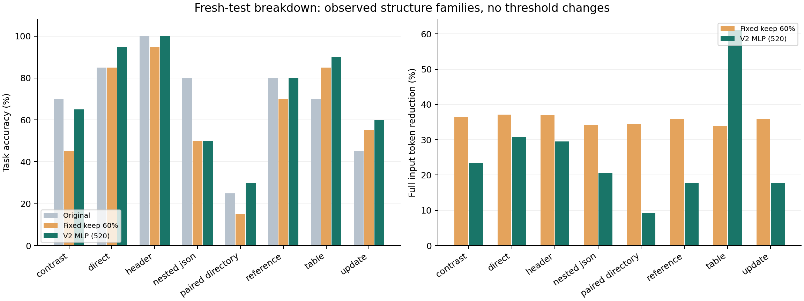

# CacheScope V2 实验结果

主模型固定为 seed 520 的 MLP。本次在 160 个新测试任务、32 个模板组上评估；所有模型和门槛在读取测试观测前已冻结。

**尚未同时达到预先设定的三项主模型条件。实测准确率 71.25%，输入 token 节省 25.94%，11 个任务由原本正确变为答错（占全部任务 6.88%）。**

## 这次改了什么

研究问题仍是：在回答模型运行前，用轻量风险模型决定是否接受固定压缩器的输出。压缩器仍产生保留60%与30%上下文的两档候选；门控选择通过门槛的最短候选，否则保留原文。V2 使用 38 维回答前特征，增加与问题相关的证据保留信息，并扩充训练数据中的结构和长度。没有用参考答案、实际回答或正确性标签作为推断特征。

训练集有 720 条任务记录，新的验证集有 80 条任务，新测试集有 160 条任务。全部旧V1测试、结构留出和长度压力数据现已归入开发数据；旧数据上的表现不能作为V2的独立验证。旧长度派生记录也不能按新增独立来源计算。

验证集负责早停和门槛选择：在经验有害接受比例≤2.5%、准确率相对原文下降≤2.5个百分点的约束下，最大化输入token节省。该经验约束不保证新测试集达到同样水平。主种子520预先固定；521、522只用于报告稳定性。

## 同一批新测试任务上的完整对照

| 策略 | 准确率 | 输入token节省 | 采用压缩 | 原本正确→答错 | 原本答错→正确 |
| --- | --- | --- | --- | --- | --- |
| 原文 | 69.38% | 0.00% | 0 | 0 | 0 |
| 固定保留60% | 62.50% | 35.57% | 160 | 25 | 14 |
| 固定保留30% | 58.13% | 60.89% | 160 | 32 | 14 |
| 简单规则门控 | 69.38% | 11.41% | 45 | 6 | 6 |
| 冻结V1 MLP | 58.13% | 59.88% | 159 | 32 | 14 |
| V2 Logistic Regression | 68.75% | 13.33% | 38 | 8 | 7 |
| V2 Random Forest | 67.50% | 37.57% | 114 | 16 | 13 |
| V2 MLP（主seed 520） | 71.25% | 25.94% | 93 | 11 | 14 |
| 旧20维特征＋V2数据MLP | 68.12% | 20.68% | 77 | 14 | 12 |
| V2 MLP（seed 521） | 71.25% | 29.11% | 103 | 12 | 15 |
| V2 MLP（seed 522） | 70.00% | 26.78% | 82 | 11 | 12 |

token节省按完整输入提示词的实际token总量计算；原本答错的任务仍计入策略准确率。表中“原本正确→答错”是压缩造成的观测退化，“原本答错→正确”是采用压缩后观测到的改善。两者相抵后的准确率变化不能代替有害接受数量。

## V1 与 V2：使用同一新测试集比较

冻结V1模型在这 160 个新任务上的准确率为 58.13%、输入token节省为 59.88%、有害接受 32 次。V2主MLP对应为 71.25%、25.94%、11 次。V2相对该V1的准确率变化为 +13.12个百分点，token节省变化为 -33.94个百分点。

固定保留60%策略的准确率为 62.50%、输入token节省为 35.57%、有害接受 25 次。V2主MLP相对它的准确率变化为 +8.75个百分点，token节省变化为 -9.63个百分点。节省比例不相等时，应同时比较准确率与token，不能直接解释为完全相同预算下的因果优势。

这里没有拿V1旧100题的准确率与V2新测试准确率直接比较；三个策略均运行于同一批已冻结的新任务。V1在这里保留旧权重、旧特征定义和旧门槛，不重新调参。

## 预定目标与不确定性

| 预先设定的条件 | 主MLP实测 | 判断 |
| --- | --- | --- |
| 输入token节省≥20% | 25.94% | 达到 |
| 准确率相对原文下降≤2.5个百分点 | +1.88个百分点 | 达到 |
| 有害接受占全部任务≤5% | 6.88% | 未达到 |

主MLP相对原文的准确率变化为 +1.88个百分点，按模板组重采样的95%区间为 [-5.63, +10.00] 个百分点；输入token节省的95%区间为 [20.07%, 32.64%]。区间反映这批合成模板任务的不确定性，不代表真实用户总体或其他回答模型。

| 主MLP对照 | MLP对/对照错 | MLP错/对照对 | 准确率差 | 组bootstrap 95%区间 | 逐题McNemar p |
| --- | --- | --- | --- | --- | --- |
| 原文 | 14 | 11 | +1.88个百分点 | [-5.62, +10.00] 个百分点 | 0.6900 |
| 固定保留60% | 21 | 7 | +8.75个百分点 | [+2.50, +15.62] 个百分点 | 0.0125 |
| 冻结V1 MLP | 22 | 1 | +13.12个百分点 | [+7.50, +20.00] 个百分点 | <0.0001 |
| 旧20维特征＋V2数据MLP | 8 | 3 | +3.12个百分点 | [+0.62, +6.25] 个百分点 | 0.2266 |
| V2 Random Forest | 7 | 1 | +3.75个百分点 | [+0.00, +8.12] 个百分点 | 0.0703 |

McNemar列使用逐任务精确二项检验，没有校正模板内相关性；优先结合模板组bootstrap区间理解。以上比较均如实报告，不用测试结果更换模型、门槛或主种子；也没有针对多重比较做校正。

## MLP、传统模型、特征消融与种子稳定性

Random Forest准确率为 67.50%、token节省为 37.57%、有害接受 16 次；主MLP对应为 71.25%、25.94%、11 次。该结果应按实际取舍解读，不能因为课程包含深度学习就声称神经网络一定优于传统模型。

保持V2扩展开发数据、改回V1旧20维特征后，MLP准确率为 68.12%、token节省为 20.68%、有害接受 14 次。这个消融使用同样的数据、架构、主种子和验证规则，但各自选择验证门槛，因此它比较整个特征加门槛方案，不能证明某单一特征的独立因果作用。

三个预定种子520/521/522的准确率均值为 70.83%，样本标准差为 0.72 个百分点；token节省均值为 27.28%，样本标准差为 1.65 个百分点。三个种子的单独结果均在上表，主结果始终使用520。

| 条件风险分类器 | 原文正确候选数 | 退化候选数 | AP | ROC-AUC |
| --- | --- | --- | --- | --- |
| V2 MLP（主seed 520） | 222 | 57 | 0.566 | 0.730 |
| V2 Logistic Regression | 222 | 57 | 0.560 | 0.649 |
| V2 Random Forest | 222 | 57 | 0.562 | 0.700 |
| 旧20维特征＋V2数据MLP | 222 | 57 | 0.372 | 0.613 |
| 冻结V1 MLP | 222 | 57 | 0.289 | 0.598 |

风险分类只在原文回答正确的候选上定义“压缩导致退化”；模型输出是该条件下学到的风险排序分数，不是对任意请求都已校准的绝对失败概率。策略表仍保留全部任务。

## 长度与结构表现

| 文本长度 | 策略 | 任务数 | 准确率 | token节省 | 有害接受 |
| --- | --- | --- | --- | --- | --- |
| 较长（≥400上下文token） | 原文 | 82 | 67.07% | 0.00% | 0 |
| 较长（≥400上下文token） | 固定保留60% | 82 | 62.20% | 36.52% | 10 |
| 较长（≥400上下文token） | 冻结V1 MLP | 82 | 47.56% | 63.86% | 20 |
| 较长（≥400上下文token） | V2 MLP（主seed 520） | 82 | 64.63% | 20.67% | 7 |
| 较短（<400上下文token） | 原文 | 78 | 71.79% | 0.00% | 0 |
| 较短（<400上下文token） | 固定保留60% | 78 | 62.82% | 33.14% | 15 |
| 较短（<400上下文token） | 冻结V1 MLP | 78 | 69.23% | 49.81% | 12 |
| 较短（<400上下文token） | V2 MLP（主seed 520） | 78 | 78.21% | 39.30% | 4 |

八种高层结构在开发数据中都出现过，新的测试任务与模板组独立。因此本次检验的是已见结构下的新来源、新措辞及不同长度任务，不能声称已经解决完全新结构的分布外泛化。较长文本的400-token分层也不等于真实长文档基准。

## 审计状态与复现材料

| 审计文件记录项 | 实际值 |
| --- | --- |
| pass | True |
| development_task_records | 600 |
| new_task_records | 360 |
| candidate_rows_verified | 1920 |
| unique_real_cached_responses | 2880 |
| new_real_cached_responses | 1080 |
| wording_family_splits_disjoint | True |
| new_old_task_and_source_ids_disjoint | True |
| labels_recomputed_from_real_answers | True |
| prompt_hash_cache_identity_digest_options_verified | True |
| backend_and_local_full_prompt_tokens_match | True |
| new_features_recomputed_exactly | True |
| frozen_protocol_hashes_match | True |

[独立审计JSON](results/verification.json)

[完整真实指标JSON](results/metrics.json)

[测试前冻结的模型／门槛与哈希](results/frozen_model_selection.json)

[策略结果CSV](results/policy_results.csv)

[逐任务策略决策](results/task_policy_decisions.jsonl)

本项目数据与代码生成使用了AI辅助。数据为人为设定事实的合成任务；标签来自实际本地回答模型输出与预定答案的匹配。结果只支持这套任务、压缩器和回答模型的观测结论。它不直接证明真实文档、其他语言、其他大模型、API费用或端到端延迟上的收益。

[这轮真正改善了什么](docs/UPGRADE_SUMMARY.md) · [真实失败与改善案例](docs/FAILURE_ANALYSIS.md)
