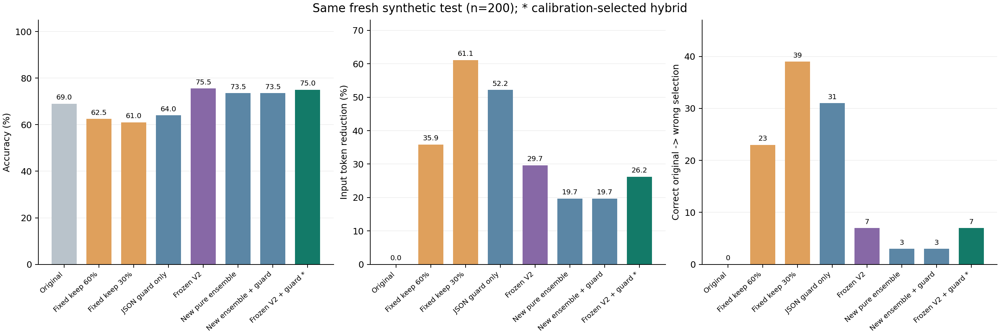
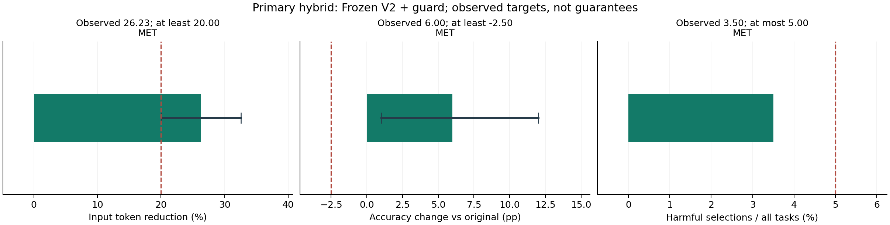
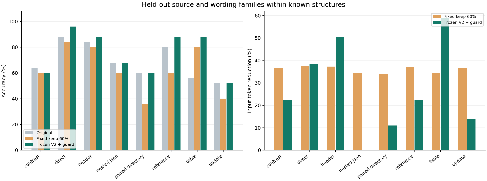

# CacheScope V3 实验结果

最终主方案是“冻结V2 MLP＋JSON检查（新校准）”，由新校准集选出，并在这 200 个新测试任务、40 个来源／措辞模板组上评估。它是神经风险分数与显式JSON结构检查组成的混合方案，不能称为纯MLP。

**本批观测达到三项预定目标：准确率 75.00%，完整输入token节省 26.23%；7/200 题由原本正确变为答错（3.50%）。达到经验目标不代表未来数据的风险保证。**

## 新训练、校准和主方案的归属

旧V1/V2的 960 条任务记录现在全部是开发数据，其中旧的50条长度派生记录仍共享来源；原有测试不再为V3提供独立验证。内部按组划分选择训练轮数后，在旧开发数据上重训权重；新的 160 题只负责阈值和主方案选择；最后 200 题不参与拟合或选择。

本次校准选中了冻结V2权重加新门槛和JSON结构检查的方案。新训练的54维MLP集成虽已完成训练，但没有入选主方案；因此主结果的改善不能归因于新训练权重。新训方案和三个单种子的真实结果仍完整保留，不能用较好测试种子替代主方案。

校准预先按有害接受上限 1.25%, 1.88%, 2.50% 从严到宽检查，首先选择存在至少20%输入token节省的档，再在该档比较预定混合候选；本次冻结采用的经验上限为 1.25%。同时要求校准准确率相对原文下降不超过1.25个百分点。最终测试的三项目标保持20%节省、准确率下降不超过2.5个百分点、有害接受不超过5%。

| 主方案在哪一阶段 | 任务数 | 准确率 | 输入token节省 | 有害接受次数 |
| --- | --- | --- | --- | --- |
| 新校准集（用于选择） | 160 | 80.62% | 25.80% | 2 |
| 新测试集（用于最终评价） | 200 | 75.00% | 26.23% | 7 |

结构检查只拒绝“原文是合法JSON容器、压缩后无法解析为JSON容器”的候选；其余风险由学习到的分数决定。它不是语义验证器。所有特征与结构判断只使用原文、问题、候选文本和token数，不读取参考答案、实际回答或正确性。

## 同一新测试集上的全部 16 项策略

| 策略 | 准确率 | 输入token节省 | 采用压缩 | 原文正确→答错 | 原文错误→答对 |
| --- | --- | --- | --- | --- | --- |
| 原文 | 69.00% | 0.00% | 0 | 0 | 0 |
| 固定保留60%上下文 | 62.50% | 35.86% | 200 | 23 | 10 |
| 固定保留30%上下文 | 61.00% | 61.13% | 200 | 39 | 23 |
| 简单保留率规则 | 66.50% | 15.34% | 84 | 10 | 5 |
| 仅JSON结构检查 | 64.00% | 52.19% | 175 | 31 | 21 |
| 冻结V2 MLP（原门槛） | 75.50% | 29.67% | 130 | 7 | 20 |
| 冻结V2 MLP＋JSON检查（新校准）【校准入选主方案】 | 75.00% | 26.23% | 117 | 7 | 19 |
| 新训纯MLP（seed 520） | 74.50% | 26.12% | 108 | 3 | 14 |
| 新训纯MLP（seed 521） | 73.00% | 24.32% | 103 | 5 | 13 |
| 新训纯MLP（seed 522） | 74.50% | 21.61% | 97 | 3 | 14 |
| 新训纯MLP集成（3分数取最大值） | 73.50% | 19.67% | 88 | 3 | 12 |
| 新训MLP集成＋JSON检查 | 73.50% | 19.67% | 88 | 3 | 12 |
| 新训Logistic Regression | 75.50% | 24.83% | 107 | 3 | 16 |
| 新训Random Forest | 73.00% | 20.90% | 98 | 5 | 13 |
| 新训LR＋JSON检查 | 75.50% | 24.83% | 107 | 3 | 16 |
| 新训RF＋JSON检查 | 72.50% | 27.42% | 118 | 8 | 15 |

每项策略按任务计一次准确率，原文答错的题仍在分母内。“原文正确→答错”和“原文错误→答对”分别报告，不能仅用两者相抵后的净准确率隐藏压缩退化。不同策略的压缩程度与校准门槛不同，不能把不同token预算下的准确率差解释为预算完全相同时的因果优势。

## 三项目标与不确定性

| 预定目标 | 主方案实测 | 本批判断 |
| --- | --- | --- |
| 输入token节省≥20% | 26.23% | 达到 |
| 准确率相对原文下降≤2.5个百分点 | +6.00个百分点 | 达到 |
| 有害接受占全部任务≤5% | 3.50% | 达到 |

主方案相对原文准确率差为 +6.00个百分点，按模板组配对bootstrap得到的95%区间为 [+1.00, +12.00] 个百分点；输入token节省区间为 [20.01%, 32.57%]。点估计达标不代表已经证明统计上的非劣性，也不意味着在未来任务中保证同样的风险上限。

| 主方案对照 | 主方案对/对照错 | 主方案错/对照对 | 准确率差 | 组bootstrap 95%区间 | 逐题McNemar p |
| --- | --- | --- | --- | --- | --- |
| 原文 | 19 | 7 | +6.00个百分点 | [+1.00, +12.00] 个百分点 | 0.0290 |
| 固定保留60%上下文 | 29 | 4 | +12.50个百分点 | [+7.00, +18.01] 个百分点 | <0.0001 |
| 固定保留30%上下文 | 33 | 5 | +14.00个百分点 | [+8.99, +19.01] 个百分点 | <0.0001 |
| 冻结V2 MLP（原门槛） | 0 | 1 | -0.50个百分点 | [-1.50, +0.00] 个百分点 | 1.0000 |
| 新训纯MLP集成（3分数取最大值） | 9 | 6 | +1.50个百分点 | [-2.00, +4.51] 个百分点 | 0.6072 |
| 仅JSON结构检查 | 25 | 3 | +11.00个百分点 | [+6.00, +16.00] 个百分点 | <0.0001 |
| 新训MLP集成＋JSON检查 | 9 | 6 | +1.50个百分点 | [-2.00, +4.51] 个百分点 | 0.6072 |

McNemar值是逐任务精确二项检验，未校正模板内相关性；模板组bootstrap也受有限组数影响。比较没有多重检验校正，不能据单一p值宣称普遍优越。极小p值按“<0.0001”展示，完整精确值保留在指标JSON。

## 纯神经、结构规则与混合策略的区别

新训纯MLP集成（3分数取最大值）：准确率 73.50%、token节省 19.67%、有害接受 3 次；新训MLP集成＋JSON检查：对应为 73.50%、19.67%、3 次。这些策略各自采用已冻结的校准门槛；差异反映整个策略，不能全部归因于加了一个检查。

冻结V2 MLP（原门槛）：准确率 75.50%、token节省 29.67%、有害接受 7 次；冻结V2 MLP＋JSON检查（新校准）：对应为 75.00%、26.23%、7 次。这些策略各自采用已冻结的校准门槛；差异反映整个策略，不能全部归因于加了一个检查。

冻结V2纯模型在本批新测试同样达标，而且准确率和token节省均高于锁定主方案，有害接受同为7次。因此本批测试不能证明JSON检查带来净收益。三个预定重训单种子MLP也均达到三目标，seed520为74.50%准确率、26.12%节省、1.50%退化率；其对照身份不替换校准选定的主方案。见[达标核对与解释](docs/GOAL_CHECK.md)。

仅JSON结构检查的准确率为 64.00%、token节省为 52.19%、有害接受 31 次。这个对照用于区分显式规则与神经风险门控，不能只展示混合方案而声称全部收益都来自深度学习。

三个预定纯MLP种子的测试准确率均值为 74.00%，样本标准差为 0.87 个百分点。三个种子均在完整表中，主方案身份由校准记录决定；最大值集成也不是测试后挑选最好种子。

| 条件风险分数 | 原文正确候选数 | 退化候选数 | AP | ROC-AUC |
| --- | --- | --- | --- | --- |
| 新训纯MLP（seed 520） | 276 | 62 | 0.659 | 0.834 |
| 新训纯MLP（seed 521） | 276 | 62 | 0.671 | 0.824 |
| 新训纯MLP（seed 522） | 276 | 62 | 0.637 | 0.823 |
| 新训纯MLP集成（3分数取最大值） | 276 | 62 | 0.669 | 0.831 |
| 新训MLP集成＋JSON检查 | 276 | 62 | 0.432 | 0.795 |
| 新训Logistic Regression | 276 | 62 | 0.644 | 0.826 |
| 新训Random Forest | 276 | 62 | 0.633 | 0.785 |
| 新训LR＋JSON检查 | 276 | 62 | 0.424 | 0.792 |
| 新训RF＋JSON检查 | 276 | 62 | 0.401 | 0.752 |
| 冻结V2 MLP＋JSON检查（新校准） | 276 | 62 | 0.412 | 0.760 |

风险分类的退化标签定义在原文答对的候选上；分数是未校准的条件风险排序，不是任意请求的绝对错误概率。混合分数含结构拒绝编码，相关AP/AUC也不能当成纯神经模型指标。

## 长度与结构分项

| 长度层 | 策略 | 任务数 | 准确率 | 输入token节省 | 有害接受 |
| --- | --- | --- | --- | --- | --- |
| 较长（≥400上下文token） | 原文 | 98 | 64.29% | 0.00% | 0 |
| 较长（≥400上下文token） | 固定保留60%上下文 | 98 | 58.16% | 36.97% | 10 |
| 较长（≥400上下文token） | 冻结V2 MLP（原门槛） | 98 | 66.33% | 24.88% | 4 |
| 较长（≥400上下文token） | 新训纯MLP集成（3分数取最大值） | 98 | 64.29% | 14.53% | 1 |
| 较长（≥400上下文token） | 冻结V2 MLP＋JSON检查（新校准） | 98 | 65.31% | 20.09% | 4 |
| 较短（<400上下文token） | 原文 | 102 | 73.53% | 0.00% | 0 |
| 较短（<400上下文token） | 固定保留60%上下文 | 102 | 66.67% | 33.34% | 13 |
| 较短（<400上下文token） | 冻结V2 MLP（原门槛） | 102 | 84.31% | 40.50% | 3 |
| 较短（<400上下文token） | 新训纯MLP集成（3分数取最大值） | 102 | 82.35% | 31.32% | 2 |
| 较短（<400上下文token） | 冻结V2 MLP＋JSON检查（新校准） | 102 | 84.31% | 40.15% | 3 |

| 结构 | 任务数 | 原文准确率 | 主方案准确率 | 输入token节省 | 有害接受 | 改善 |
| --- | --- | --- | --- | --- | --- | --- |
| contrast | 25 | 64.00% | 60.00% | 22.29% | 2 | 1 |
| direct | 25 | 88.00% | 96.00% | 38.43% | 0 | 2 |
| header | 25 | 84.00% | 88.00% | 50.61% | 1 | 2 |
| nested_json | 25 | 68.00% | 68.00% | 0.00% | 0 | 0 |
| paired_directory | 25 | 60.00% | 60.00% | 10.96% | 1 | 1 |
| reference | 25 | 80.00% | 88.00% | 22.32% | 1 | 3 |
| table | 25 | 56.00% | 88.00% | 58.99% | 1 | 9 |
| update | 25 | 52.00% | 52.00% | 13.94% | 1 | 1 |

这些都是合成英文姓名、日期、预算事实。八类高层结构在开发数据中已见，测试留出新的来源与措辞／布局家族，不能称为完全新结构的分布外验证。400-token分层只表示本数据内的相对长度，不等于真实长文档基准。单一小型回答模型上的观测也不能推广为其他模型、语言或真实文档的保证。

## 核验、案例与复现

核验文件的整体状态：通过。

| 核验记录项 | 实测值 |
| --- | --- |
| pass | True |
| primary_policy | hybrid_frozen_v2_mlp |
| development_task_records | 960 |
| new_source_tasks | 360 |
| final_test_tasks | 200 |
| candidate_rows_verified | 2640 |
| unique_real_cached_responses | 3960 |
| new_real_cached_responses | 1080 |
| frozen_code_model_data_hashes_match | True |
| family_and_source_splits_disjoint | True |
| gold_labels_recomputed_from_real_answers | True |
| all_full_prompt_tokens_match_backend | True |
| prompt_cache_identity_digest_options_verified | True |
| final_features_recomputed_exactly | True |
| all_saved_model_scores_and_guard_flags_recomputed | True |
| primary_policy_metrics_recomputed | True |

[完整核验JSON](results/verification.json)

[全部真实指标JSON](results/metrics.json)

[测试前冻结的主方案、门槛与哈希](results/frozen_selection.json)

[完整策略CSV](results/policy_results.csv)

[逐任务已冻结策略决策](results/task_policy_decisions.jsonl)

[数据卡与范围](docs/DATA_CARD.md)

[54维特征与结构守门说明](docs/FEATURES_V3.md)

[真实失败与改善案例](docs/FAILURE_ANALYSIS.md)

数据生成、代码与文档使用了AI辅助。标签来自实际本地模型回答与预定事实的匹配。token节省使用完整输入提示词计数，不能直接解释为API费用、订阅额度或端到端延迟节省。训练、校准和测试的原始观测均应保留，未达目标的结果也不应隐藏。
